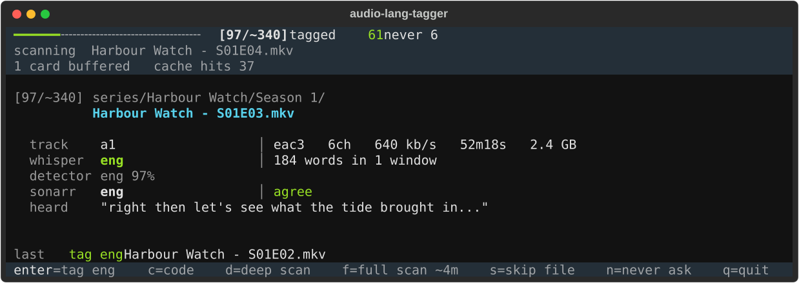

# audio-lang-tagger

Finds MKV audio tracks whose language flag is missing or `und`, guesses the
language by running a short sample through [whisper.cpp][], and asks for
confirmation before writing the tag with `mkvpropedit`.

Nothing in that path cares what the video is. Any Matroska file with an
unlabelled audio track qualifies: a lecture recording, a conference talk, a
home video, digitised archive footage, a film. A media library is just the
thing that produces thousands of them at once, which is what the saved queue,
the sweep and the unattended pass are shaped around.

The edit is a track-header change, not a remux: nothing is re-encoded, no data
is copied, and a 40 GB file is tagged in well under a second. Players stop
labelling those tracks "Unknown", and any later pass that strips unwanted audio
can work on the assumption that everything left is identified.

[whisper.cpp]: https://github.com/ggml-org/whisper.cpp



## Quick start

Needs Python 3.11+ (nothing to `pip install`), whisper.cpp, ffmpeg and
mkvtoolnix. The script is one file:

```bash
brew install whisper-cpp ffmpeg mkvtoolnix           # macOS
sudo pacman -S whisper-cpp ffmpeg mkvtoolnix-cli     # Arch
sudo apt install whisper.cpp ffmpeg mkvtoolnix       # Debian 13+, Ubuntu 26.04+
sudo dnf install whisper-cpp ffmpeg mkvtoolnix       # Fedora
# no whisper.cpp package (Ubuntu 24.04 and older)? snap install whisper-cpp,
# or build it: https://github.com/ggml-org/whisper.cpp

# the language model, once (~150 MB)
mkdir -p ~/.local/share/whisper
curl -L -o ~/.local/share/whisper/ggml-base.bin \
  https://huggingface.co/ggerganov/whisper.cpp/resolve/main/ggml-base.bin

curl -LO https://github.com/polybjorn/audio-lang-tagger/releases/latest/download/audio-lang-tagger.py
chmod +x audio-lang-tagger.py
./audio-lang-tagger.py --list /path/to/your/video   # count untagged tracks, change nothing
./audio-lang-tagger.py /path/to/your/video          # tag, confirming each track
```

If anything is missing the tool says exactly what and how to install it, and
`--show-config` prints every resolved path and connection. For your PATH:
`install -m 755 audio-lang-tagger.py ~/.local/bin/`.

That URL always serves the newest stable release, never a beta or an
unreleased `main`. To update, download it again.

### Testing a beta

Betas are published as pre-releases, which `latest` skips. Fetch one by its tag
from the [releases page](https://github.com/polybjorn/audio-lang-tagger/releases):

```
curl -LO https://github.com/polybjorn/audio-lang-tagger/releases/download/v1.9.0-beta.1/audio-lang-tagger.py
```

`--version` then prints the beta tag. Go back to stable with the `latest` URL
above.

## Usage

```bash
audio-lang-tagger.py PATH [PATH...]   # work through the given files/dirs
audio-lang-tagger.py                  # work the saved candidate queue
audio-lang-tagger.py --list           # report untagged tracks, change nothing
audio-lang-tagger.py --full           # re-sweep every configured root
audio-lang-tagger.py --auto           # tag gate-passing tracks, prompt for the rest
audio-lang-tagger.py --prescan        # unattended: scan + cache, never prompt
audio-lang-tagger.py --bulk zxx PATH  # one code over a range you have judged
audio-lang-tagger.py --plain          # line-mode prompts, no full-screen UI
audio-lang-tagger.py --ledger         # review the last 20 applied tags
audio-lang-tagger.py --undo 3         # revert the last 3 tags to und
audio-lang-tagger.py --show-config    # print resolved paths and exit
audio-lang-tagger.py --version        # print the version and exit
```

Interactive modes need a tty. Over ssh that means `ssh -t HOST
audio-lang-tagger.py`.

The interactive run is the full-screen app in the screenshot above (via
[textual][], optional - `pip install textual`; without it the tool falls back
to plain line-mode prompts). Keys are single presses, no Enter:

| Key | Does |
|---|---|
| `Enter` | tag with the suggested code |
| `c` | type a different code (`esc` cancels) |
| `d` / `f` | deep or full scan, when the samples were not enough |
| `s` | skip this file for now |
| `n` | never ask about this track again |
| `u` | undo the last decision, one level (full-screen UI only) |
| `q` | quit cleanly, flushing the scan cache and pruning the queue |

`u` re-shows the card it took back: a tag is written back to `und` with a
corrective ledger row, a never-ask comes out of the skip list.

[textual]: https://textual.textualize.io/

## Configuration

Each setting resolves as CLI flag, then `AUDIO_LANG_TAGGER_<NAME>` in the
environment, then `~/.config/audio-lang-tagger.conf`, then
`/etc/audio-lang-tagger.conf` (`KEY=value`), then the default. The four arr
connection keys take no prefix. Example:
[`audio-lang-tagger.conf.example`](audio-lang-tagger.conf.example);
[configuration](docs/configuration.md) has the detail.

| Flag | Config key | Default |
|---|---|---|
| `--media-dir DIR` (repeatable) | `MEDIA_DIRS` (`:`-separated) | none - only `--full` and queue runs need it |
| `--state-dir DIR` | `STATE_DIR` | `$XDG_STATE_HOME/audio-lang-tagger` |
| `--queue-file PATH` | `QUEUE_FILE` | `untagged_audio.json` in the state dir |
| `--model PATH` | `MODEL` | first existing of `~/.local/share/whisper/ggml-base.bin`, `/var/lib/whisper/ggml-base.bin`, `/usr/share/whisper.cpp/ggml-base.bin`, `/usr/local/share/whisper.cpp/ggml-base.bin` |
| `--whisper-bin PATH` | `WHISPER_BIN` | `whisper-cli` / `whisper-cpp` / `whisper` on PATH |
| `--realtime-factor N` | `REALTIME` | `20` |
| `--sonarr-config PATH` | `SONARR_CONFIG` | `/var/lib/sonarr/config.xml` |
| `--radarr-config PATH` | `RADARR_CONFIG` | `/var/lib/radarr/config.xml` |
| - | `SONARR_URL`, `SONARR_API_KEY` | read from Sonarr's `config.xml` |
| - | `RADARR_URL`, `RADARR_API_KEY` | read from Radarr's `config.xml` |
| `--ignore PATTERN` (repeatable) | `IGNORE` (`:`-separated) | trailers, samples, extras folders |
| `--no-ignore` | - | filter enabled |
| `--no-arr` | - | arr lookup enabled |
| `--jobs N` | - | `2` |

## Corroboration: Sonarr/Radarr

Optional interactively, **required for `--auto`**: unattended tagging needs two
independent answers to agree - whisper hears "this is Italian", and something
that already knows what the recording is says "this was made in Italian". A
track with no metadata match is never auto-tagged. Without an arr the card just
lacks its agree/disagree line. A native install on the same host is read from
its `config.xml`; anywhere else, set the URL and key pair
([setup](docs/configuration.md#connecting-sonarr-and-radarr)). Check
`--show-config` before relying on `--auto`: a failed lookup at runtime degrades
silently to fewer tracks passing the gates.

## Scope

Matroska only: the write is an in-place MKV track-header edit, and MP4/MOV
have no backend yet. [ULDAS][uldas] is the more capable choice for a library
handled unattended; this tool assumes you would rather confirm
([scope](docs/scope.md)).

[uldas]: https://github.com/netplexflix/MKV-Undefined-Audio-Language-Detector

## Tests

Stdlib only: `python3 -m unittest discover -s tests` from a clone. CI runs the
same smoke suite on every push; [development](docs/development.md) lists what
it covers.

## Docs

- [How it decides](docs/how-it-decides.md): the scan, the `--auto` gates, bulk
- [Configuration](docs/configuration.md): resolution, realtime factor, arrs
- [State and queue](docs/state-and-queue.md): ledger, undo, queue, concurrency
- [Scope](docs/scope.md): why it asks, and ULDAS and track strippers
- [Development](docs/development.md): what the test suite covers
- [Design notes](docs/design-notes.md): the measurements behind each gate

Bug reports with a `--version` and a ledger row are welcome.

## License

MIT, see [LICENSE](LICENSE).
