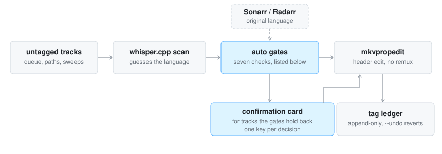

# How it decides

What a scan measures, when `--auto` may tag without asking, and how `--bulk`
covers the calls no scan can make. The [design notes](design-notes.md) carry
the measurements behind each threshold.

<picture>
  <source media="(prefers-color-scheme: dark)" srcset="pipeline-dark.svg">
  
</picture>

Language detection off a 30-second sample is wrong often enough that blind
tagging is not usable, and wrong in two opposite ways: whisper's language head
fires confidently on music, and reads low on a track that opens with a title
score ([design notes](design-notes.md#detection-is-wrong-in-a-specific-way)
carry the measurements).

So the tool separates the two questions. *Are there words here* is answered from
the transcript (character count, word count, distinct-word ratio), *which
language* from the detector - and a detection with no transcript behind it is
never offered as the default. The rest is about making a confirmation cheap:

- Tracks short enough to transcribe whole (~12 min of audio) are, so the first
  card is conclusive rather than a starting point. The detector is then asked a
  second time about the densest 30 seconds of *speech*, because its first
  reading only ever saw the opening. Longer tracks sample four windows and stop
  at the first one holding words.
- `d` (deep scan) samples 7 more windows for sparse-dialogue content; `f` (full
  scan) transcribes the whole track, the only pass where finding nothing is
  conclusive.
- Every whisper result is cached by path + mtime + track, so an interrupted
  sweep resumes for free. Measured on one file: 34s cold, 1s warm.
- Every applied tag is appended to a TSV ledger, so a bad batch or a misclick
  is reviewable with `--ledger` and reversible with `--undo`
  ([state and queue](state-and-queue.md#the-ledger-and-undo)).

Every threshold was calibrated against the `base` model on a 6-core CPU. A
larger model, or material unlike what it was tuned on, will read differently -
watch `--auto` on your own content before trusting it.

## Unattended tagging

`--auto` tags without asking only when every gate passes. The constants that
tune the seven are at the top of the script, which is where to go if your
material needs different thresholds:

1. **Unanimous, confident detections** - every window at p >= 0.90, or a
   whole-track pass reaching it on the opening or the densest speech window
   (`AUTO_PROB`)
2. **Coherent transcript** - enough characters, words and distinct vocabulary
   to rule out music hallucination (`AUTO_MIN_CHARS`, `AUTO_MIN_WORDS`,
   `AUTO_MIN_UNIQUE`; long transcripts `AUTO_LONG_MIN_DISTINCT`,
   `AUTO_LONG_MIN_UNIQUE`)
3. **Corroboration** - the arr's original language matches; no metadata match
   means no auto-tagging at all
4. **Year** - 1940 or later, using the episode's own air year where Sonarr
   knows it (`AUTO_MIN_YEAR`; older content is sparse-dialogue territory)
5. **Genre** - not music or concert (`AUTO_EXCLUDE_GENRES`)
6. **One audio track** - a single non-commentary track in the file
7. **Unambiguous language** - not `nn`, `da` or `sv`, which whisper confuses
   with each other and with `no` (`AUTO_EXCLUDE_ISO1`)

"No speech found" never auto-tags anything.

The intended shape for a large queue is `--prescan` in the background first
(unattended, tags gate-passers, caches everything else), then an interactive
pass that does no scanning at all. Cached files are served first either way, so
a partially prescanned queue still opens with instant cards.

### Why Sonarr and Radarr

Corroboration needs a source that already knows what the recording is.
Sonarr and Radarr are the source that is implemented. Any source that can state
a recording's intended language would serve the same role, but the obvious
candidates do not carry the fact: Jellyfin and the Kodi NFO standard do not
store original language, and TMDB does but cannot be asked about a path
([design notes](design-notes.md#why-only-sonarr-and-radarr-corroborate)).

## Bulk tagging

`--bulk CODE PATH...` sets one language across a range after a single
confirmation, for the calls no scan can make - a run of pre-sound-era shorts
where `zxx` (no linguistic content) versus `eng` is a human judgement about
sparse dialogue. It never scans, and a cached scan contradicting the code holds
its file back for the interactive pass. `zxx` is checked far more suspiciously
than a language code, because it claims absence.
